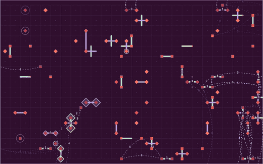

# Live surface code

A real-time simulation of a planar surface code with bit-flip, phase-flip and measurement errors, decoded by minimum-weight perfect matching in spacetime. It is plain JavaScript with no dependencies, and it runs in the browser.



It is the animated background of [hertaspace.github.io](https://hertaspace.github.io). The [How it works](https://hertaspace.github.io/how-it-works.html) page explains what is on screen.

## Run it

Open `demo/index.html` in a browser. There is nothing to install or build.

The panel sets the error rates and the round length. Pause holds the simulation. The 2D, 3D, Time and Side views show the same pattern, with time as an extra direction in the last three. In 2D, hold the left mouse button on the lattice to disturb qubits.

## Files

- `src/mwpm.js`: exact minimum-weight perfect matching, by Edmonds' blossom algorithm, O(n^3).
- `src/surface.js`: the planar code, matching with a boundary, and the streaming spacetime decoder.
- `src/view.js`: the canvas view, with the 2D and 3D camera and the controls.
- `test/`: the checks below.

## Checks

```
npm test              # exact matching, streaming decoder, misread detection
npm run threshold     # thresholds with and without measurement errors, a few minutes
npm run window        # sliding window against no truncation, several minutes
```

- The matching agrees with brute-force enumeration on 37,600 random graphs, and the boundary version agrees on 4,000 more.
- With measurement errors at the same rate as data errors, the batch decoder shows a crossing near 3%. [Wang, Harrington and Preskill](https://arxiv.org/abs/quant-ph/0207088) report about 2.9% for this noise model. These runs are small, so the crossing is approximate.
- For the streaming decoder, the parity of the logical failure count matches an independent record of every error and correction.

## Limits

This is a demonstration, not a research simulator.

- Only Pauli errors are tracked, classically. No quantum state is simulated.
- Measurement errors are modelled directly, with no gate-level circuit.
- Weights are plain lattice distances.
- X and Z errors are decoded separately, so the correlation in a Y error is ignored.
- The decoder streams, so committed pairs are never revisited. Each round considers at most 110 events per lattice from a window of eight rounds, so the result is not a global optimum.

## License

Apache License 2.0, see `LICENSE`.
